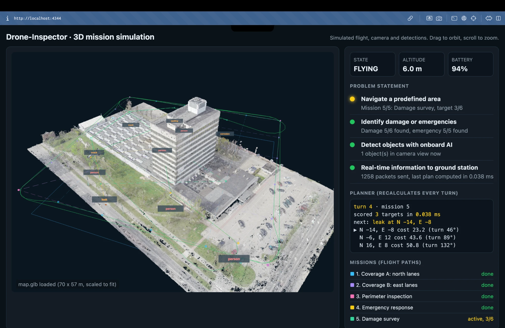
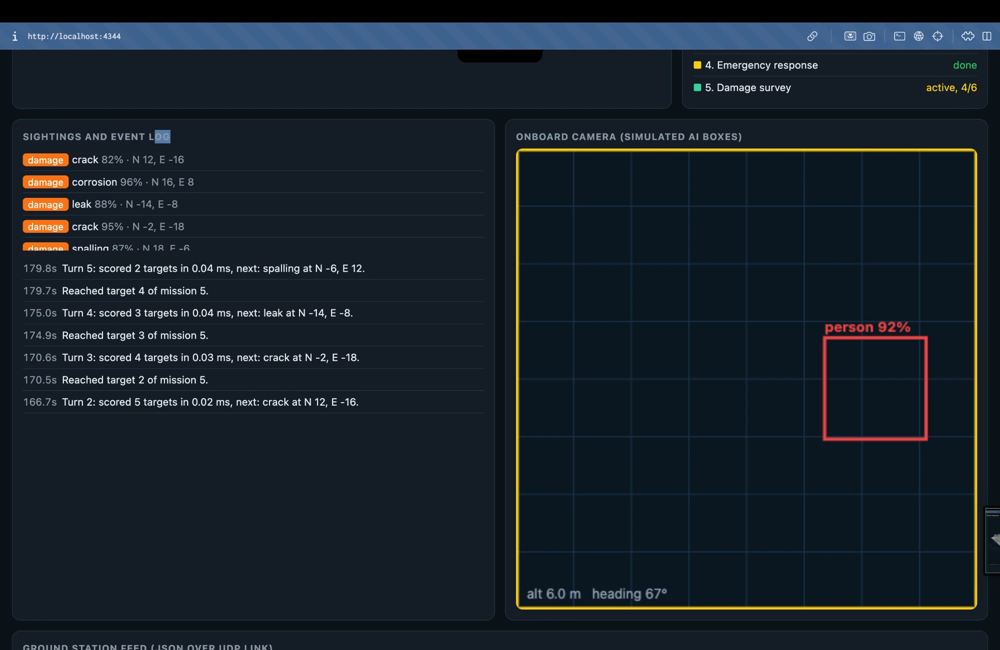

# Drone-Inspector

Drone-Inspector is an autonomous drone simulation for infrastructure inspection and emergency response. It runs on PX4 + ROS 2 + Gazebo + YOLO, and it is set up with one script instead of many hand-installed dependencies.

The simulated drone can:

1. **Patrol a predefined area** in a lawnmower pattern, then return home and land.
2. **Detect objects and emergencies** with an onboard YOLO model: people are flagged as emergencies, and infrastructure damage is flagged when custom weights are used.
3. **Send information to a ground station in real time**: mission progress and detections go out as JSON over UDP, and every detection is logged with the drone's position.

It also includes an orbit-inspection mission and a search-and-rescue mission in a simulated open-pit mine (the PHOENIX mine world).

## Features

| Feature | What it does |
| --- | --- |
| **Area patrol** (`./sim.sh --patrol`) | Flies a lawnmower route over the rectangle set in `config/area_patrol.yaml`, then returns home and lands. |
| **Detection and emergency flags** | YOLO detections are labelled `emergency` (person) or `damage` (custom weights such as crack or spalling). Each detection is written to `data/inspection_report.csv` with the drone's position. |
| **Ground-station link** | Progress and detections are sent as JSON over UDP to `GROUND_STATION_HOST:GROUND_STATION_PORT` (default `127.0.0.1:14560`). Listen with `nc -ul 14560`. |
| **Orbit inspection** (`./sim.sh`) | The drone orbits a car, a pickup and a person while YOLO detects them. |
| **Search and rescue** (`./sim.sh --sar`) | The drone enters the PHOENIX mine, searches the tunnels, finds an injured worker, raises an alert and returns home. |
| **One-command launcher** (`sim.sh`) | Starts every process in the right order and waits for each one to be ready. `./sim.sh stop` cleans up. |
| **Apple Silicon (M4) support** | Runs in an arm64 Ubuntu container (`docker-compose.mac.yml`). YOLO uses the Mac GPU (MPS) when it runs natively. See [installation_guide/README_APPLE_SILICON_M4.md](installation_guide/README_APPLE_SILICON_M4.md). |

> Simulation only. This project is not intended for flying real aircraft.

## Architecture

```text
                 sensors (IMU, GPS, baro)
   Gazebo  ---------------------------------->  PX4 SITL autopilot
   (world + x500_depth drone)  <------------     (flight brain)
      |            motor commands                    ^
      | camera                                       | Micro XRCE-DDS Agent
      v                                              v
   ROS 2 image bridge                    ROS 2 network (your nodes)
      |  /camera/image_raw              - area_patrol_mission  (patrol)
      +------------------------------>  - orbit_controller     (orbit)
                                        - mine_sar_mission     (search & rescue)
                                        - mission_monitor      (altitude, speed)
                                        - YOLO detection       (/inspection/detections)
                                                 |
                                                 v  UDP JSON
                                          ground station (port 14560)
```

- **PX4 v1.15 SITL** flies the drone (software-in-the-loop, no hardware needed).
- **Gazebo** simulates the world, the drone and its camera.
- **ROS 2 Humble** connects everything. Mission nodes send setpoints to PX4 and read its odometry.
- **YOLOv8** (Ultralytics) detects objects in the camera stream.
- **MAVSDK keyboard teleop** lets you fly manually.

## Requirements

| Item | Requirement |
| --- | --- |
| OS | Ubuntu **22.04** (native or WSL2), or an arm64 Ubuntu 22.04 container on Apple Silicon |
| Windows users | Windows 10/11 with **WSL2 + WSLg** (for the Gazebo window) |
| Disk space | about 25 GB free |
| RAM | 16 GB recommended |
| GPU | Optional. NVIDIA GPU with the driver installed on **Windows** (not inside WSL). Apple Silicon uses MPS for YOLO when run natively. |
| Internet | Needed during setup (large downloads) |

Ubuntu 24.04 is **not** supported, because ROS 2 Humble targets Ubuntu 22.04.

## Quick start (Ubuntu 22.04 or WSL2)

### 1. Install Ubuntu 22.04 on WSL2 (Windows only)

In Windows PowerShell:

```powershell
wsl --update
wsl --install -d Ubuntu-22.04
```

Open the Ubuntu terminal and create your user.

### 2. Clone the repository

The folder name and location matter. Clone it into your home directory with exactly this name:

```bash
sudo apt update && sudo apt install -y git git-lfs
git clone https://github.com/geekyNads/drone-inspector.git ~/drone-inspector
cd ~/drone-inspector
git lfs pull
```

### 3. Install everything

```bash
chmod +x scripts/*.sh sim.sh
./scripts/setup_all.sh
sudo apt install -y tmux python3-tk      # used by sim.sh and the victim alert pop-up
```

The script auto-detects an NVIDIA GPU. You can also force a mode:

```bash
./scripts/setup_all.sh --cpu    # CPU-only PyTorch
./scripts/setup_all.sh --gpu    # CUDA PyTorch
```

This takes **1 to 2 hours** (ROS 2, PX4 build, PyTorch). You can safely re-run it if it stops, because finished steps are skipped. Progress is saved in `logs/setup_all.log`.

### 4. Run a mission

Open a **normal terminal** (not inside an existing `tmux` session):

```bash
cd ~/drone-inspector

./sim.sh                 # orbit inspection (empty world + car, pickup, person)
./sim.sh --sar           # search and rescue in the PHOENIX mine world
./sim.sh --patrol        # lawnmower patrol over the predefined area
```

`sim.sh` starts everything in this order and waits for each step before the next:

```text
DDS agent -> Gazebo world -> spawn the drone -> PX4 attaches to it -> objects
          -> camera bridge -> mission node (orbit, SAR or patrol)
```

The first start can take 1–2 minutes on WSL, so wait for `[sim] All started`. Everything runs in one `tmux` session, with one tab per part:

| Tab | What it runs |
| --- | --- |
| `control` | Your free terminal, with the mission shortcuts ready |
| `agent` | Micro XRCE-DDS Agent (PX4 <-> ROS 2) |
| `gazebo` | Gazebo server with the selected world |
| `px4` | PX4 SITL, attached to the `x500_depth_0` drone |
| `camera` | Gazebo camera to ROS 2 (`/camera/image_raw`) |
| `orbit`, `sar` + `monitor`, `patrol` | The mission node for the chosen mission |
| `yolo`, `view`, `teleop`, `record` | Optional, see the options below |

To get around:
- Click a tab at the bottom, or press `Ctrl+b` then its number.
- Press `Ctrl+b` then `d` to hide the session; it keeps running. `./sim.sh attach` brings it back.
- **Do not press `Ctrl+C`** in the agent, gazebo, px4, camera or mission tabs, because that stops that part. Type your own commands in `control`, or open a new tab with `Ctrl+b` then `c`.

### 5. Control the mission

In the `control` tab:

| Command | What it does |
| --- | --- |
| `orbit_start` | Start the orbit mission (`./sim.sh`) |
| `orbit_abort` | Abort the orbit and land |
| `sar_start` | Start the search-and-rescue mission (`./sim.sh --sar`) |
| `sar_status` | Follow the SAR mission live |
| `sar_abort` | Fly home now, along the explored path |
| `sar_land` | Land where the drone is |
| `patrol_start` | Start the area patrol (`./sim.sh --patrol`) |
| `graph` | Open `rqt_graph` (nodes and topics) |

These are shortcuts for the usual ROS 2 calls, for example `ros2 service call /sar/start std_srvs/srv/Trigger "{}"`.

### 6. Stop everything

From a normal terminal (press `Ctrl+b` then `d` first if you are inside the session):

```bash
./sim.sh stop
```

### All `sim.sh` options

| Command | Effect |
| --- | --- |
| `./sim.sh` | Orbit mission, default world |
| `./sim.sh --sar` | Search-and-rescue mission (uses the `phoenix_mine` world automatically) |
| `./sim.sh --patrol` | Area patrol (uses `config/area_patrol.yaml`) |
| `./sim.sh --world phoenix_mine` | Orbit mission in the mine world |
| `--yolo` | Also start YOLO detection |
| `--view` | Also open the camera image (`rqt_image_view`) |
| `--teleop` | Also open the keyboard-control tab |
| `--record` | Also record a rosbag in `data/bags/` |
| `--all` | yolo + view + teleop + record |
| `--auto-start` | Start the mission automatically when everything is ready |
| `--headless` | No Gazebo window (faster, but no alert markers) |
| `--no-objects` | Do not spawn the car / pickup / person |
| `./sim.sh attach` | Re-open the tabs after closing the terminal |
| `./sim.sh stop` | Stop everything |

## Area patrol

The drone climbs to the patrol altitude, flies back and forth across the rectangle, then flies home and lands. The area and altitude are set in `ros2_ws/src/px4_orbit_inspection/config/area_patrol.yaml`:

| Parameter | Default | Meaning |
| --- | --- | --- |
| `north_min_m`, `north_max_m` | -20, 20 | Patrol extent to the north of take-off (m) |
| `east_min_m`, `east_max_m` | -20, 20 | Patrol extent to the east of take-off (m) |
| `lane_spacing_m` | 8.0 | Distance between patrol lanes (m) |
| `altitude_m` | 6.0 | Patrol altitude (m) |
| `speed_m_s` | 2.0 | Flight speed between waypoints |
| `ground_host`, `ground_port` | 127.0.0.1, 14560 | Where progress events are sent |

Run the node by hand with `ros2 run px4_orbit_inspection area_patrol_mission`, then call `/patrol/start`.

## Detection, reporting and the ground station

`perception/yolo/uav_camera_det.py` runs YOLOv8 on the camera stream. For each detection it:

- sends a JSON event to the ground station (type `detection`, with `category` set to `emergency`, `damage` or `object`),
- appends a row to `data/inspection_report.csv` with the time, class, confidence, position (north, east, altitude), inference time and bounding box.

Environment variables (all optional):

| Variable | Default | Meaning |
| --- | --- | --- |
| `YOLO_WEIGHTS` | `yolov8m.pt` | Weights file. Use custom weights to detect damage such as cracks or spalling. |
| `YOLO_CLASSES` | `0,2` | Class ids to keep (person and car in the default weights) |
| `YOLO_DEVICE` | auto | `cpu`, `mps` (Apple GPU) or `cuda`. Auto picks CUDA, then MPS, then CPU. |
| `YOLO_VIEW` | `1` | `0` turns off the OpenCV window (headless machines) |
| `GROUND_STATION_HOST`, `GROUND_STATION_PORT` | 127.0.0.1, 14560 | Ground-station address |
| `REPORT_CSV` | `data/inspection_report.csv` | Where the report is written |

> The default weights only know people and cars. Detecting infrastructure damage needs custom-trained weights.

## Search-and-rescue mission (PHOENIX mine)

```bash
./sim.sh --sar        # then, in the control tab:
sar_start
```

| Phase | What the drone does |
| --- | --- |
| Take-off and transit | Climbs to 15 m and flies about 80 m east to the open pit |
| Entry | Descends to 1.8 m above the pit floor, then flies through the box-cut trench and Portal A |
| Search | Sweeps the underground rooms along a planned route that goes around the roof-fall |
| Detection | Detects the victim with a simulated thermal sensor (within 8 m **and** in line of sight, so pillars block it). If YOLO is running, a `person` detection underground also counts. |
| Mark | Flies over the victim, publishes its position on `/sar/victim` and hovers for 10 s |
| Return | Flies home along the **shortest path through the explored area**, then lands on the home pad |

The victim is usually found 3–4 minutes after `sar_start`, and the whole mission takes about 6 minutes.

### Victim alert

| Where | What you see |
| --- | --- |
| Pop-up window | A flashing red **VICTIM DETECTED** window with the position, the sensor, the distance and the mission time. It beeps. Click ACKNOWLEDGE to close it. |
| Gazebo | A red sphere on the victim, a red beacon going up through the rock, and a red ring on the surface above. A green line shows the flown path. |
| `tmux` bar | Turns **red** in every tab, then **green** when the drone has landed |
| `sar` tab | A large red banner and a terminal bell |
| Snapshot | `data/sar/victim_<date>_<time>.png`, the camera image at detection with a caption |
| ROS 2 | `/sar/alert` (latched `String`) and `/sar/victim` (`PointStamped`, PX4 NED) |

### Mission options

To run the node by hand with options (PX4, Gazebo and the agent already running, with a sourced terminal):

```bash
python3 -u missions/mine_sar_mission.py --ros-args -p on_found:=hover    # stay over the victim
python3 -u missions/mine_sar_mission.py --ros-args -p on_found:=land     # land 2 m from the victim
python3 -u missions/mine_sar_mission.py --ros-args -p speed_tunnel:=0.8 -p thermal_range:=6.0
```

| Parameter | Default | Meaning |
| --- | --- | --- |
| `on_found` | `return` | `return`, `hover` or `land` after marking the victim |
| `thermal_range` | 8.0 | Detection range in metres (line of sight required) |
| `speed_tunnel` / `speed_surface` | 1.2 / 4.0 | Flight speeds in m/s |
| `cruise_alt` / `tunnel_height` | 15.0 / 1.8 | Surface altitude, and height above the floor in the tunnel (m) |
| `hover_time` | 10.0 | Seconds spent over the victim |
| `alert_popup`, `gazebo_markers` | true | Turn parts of the alert on or off |
| `use_yolo`, `detections_topic` | true, `/inspection/detections` | YOLO as a second detector |
| `auto_start` | false | Start without calling `/sar/start` |

More details: [`docs/sar_mission/README.md`](docs/sar_mission/README.md).

## PHOENIX mine world

`gazebo/worlds/phoenix_mine.sdf` models a phosphate mine: a surface base, an open pit, and an underground room-and-pillar panel. It is built only from simple shapes, so it needs no internet or model downloads.

| Place | Gazebo (x, y, z) | PX4 local (N, E, D) | Notes |
| --- | --- | --- | --- |
| Home pad (spawn) | 0, 0, 0 | 0, 0, 0 | Surface plateau, ground station, solar charger, wind sock |
| Inspection silo | 0, 35, 0 | 35, 0, 0 | 14 m tall, 18 m clear around it, rust patches to inspect |
| Open pit | x 50–120, y −35–35 | — | Two 4 m benches, floor at z = −12 |
| Box-cut trench + Portal A | 50–60, 0, −12 | 0, 50, +12 | Tunnel entrance, steel arches, work lights |
| Underground panel | x 14–48, y −22–22 | — | 4 m rooms, 12 pillars, dark on purpose |
| Victim | 16, 20, −12 | 20, 16, +12 | Behind a roof-fall that blocks the direct route |
| Safe landing point | 100, 15, −12 | 15, 100, +12 | Green pad on the pit floor (contingency) |

Gazebo uses ENU (x = east, y = north). PX4 uses NED (x = north, y = east, z = down). The pit floor is 12 m **below** home, so its PX4 z is positive.

Underground hazards include a low cable across the main drift, a ventilation duct, an abandoned loader, a water puddle and the roof-fall. Details and the world generator are in [`docs/phoenix_mine_world/`](docs/phoenix_mine_world/README.md).

## Manual flight with the keyboard

The easiest way is `./sim.sh --teleop` (or `--all`), which opens a `teleop` tab. To start it by hand:

```bash
source ~/px4-venv/bin/activate
cd ~/drone-inspector/tools/mavsdk_teleop
python -u keyboard_mavsdk_control.py
```

A small window opens. **Click on it**, because the keys are read from that window.

| Key | Action |
| --- | --- |
| `r` | Arm |
| `l` | Land |
| `w` / `s` | Throttle up / down |
| `a` / `d` | Yaw left / right |
| Arrow keys | Roll / pitch |
| `i` | Print flight mode |
| `Ctrl+C` | Quit |

Do not use the keyboard while a mission is flying, because they fight for control. Abort the mission first. In the mine world the drone starts facing east, so forward (↑) flies toward the pit.

## Useful commands

```bash
# View the camera
ros2 run rqt_image_view rqt_image_view /camera/image_raw

# Check the camera rate
ros2 topic hz /camera/image_raw

# Follow the SAR mission / see the alert
ros2 topic echo /sar/status
ros2 topic echo /sar/alert

# Record an experiment (or start with ./sim.sh --record)
mkdir -p data/bags
ros2 bag record -o data/bags/run_01 \
  /camera/image_raw /inspection/debug_image /inspection/detections \
  /fmu/out/vehicle_odometry /fmu/out/vehicle_status /fmu/in/trajectory_setpoint

# Listen to the ground-station feed
nc -ul 14560
```

In a terminal you opened yourself, load the project first: `source config/project.env && source /opt/ros/humble/setup.bash`. The project uses `ROS_DOMAIN_ID=23`, so without it `ros2` cannot see the nodes.

## Repository layout

```text
drone-inspector/
├── sim.sh                 # one-command launcher: orbit, SAR or patrol, any world
├── config/                # project paths and pinned commits (PX4, px4_msgs, DDS Agent)
├── gazebo/
│   ├── worlds/            # phoenix_mine.sdf (PHOENIX mine), legacy_inspection.sdf
│   └── models/            # inspection models (car, pickup, person, ...)
├── missions/              # mine_sar_mission.py - search-and-rescue node
├── models/yolo/           # YOLO weights
├── perception/yolo/       # YOLO detection, reporting and ground-station node
├── ros2_ws/src/           # px4_orbit_inspection package (orbit, patrol, telemetry)
├── tools/mavsdk_teleop/   # keyboard flight control
├── docs/                  # world, mission and design notes
├── scripts/
│   ├── setup_all.sh       # one-command installer
│   ├── run_sim.sh         # older launcher (orbit demo)
│   ├── spawn_objects.sh   # adds objects to the Gazebo world
│   └── 02_download_sources.sh  # clones PX4 / px4_msgs / DDS Agent at pinned commits
├── installation_guide/    # step-by-step guides (Ubuntu, phases, Apple Silicon)
└── docker-compose.mac.yml # Apple Silicon (arm64) container
```

## What is not stored in this repository

Large or machine-specific parts are recreated by `setup_all.sh`:

| Item | Where it comes from |
| --- | --- |
| PX4-Autopilot, Micro-XRCE-DDS-Agent, `px4_msgs` | Downloaded at pinned commits by `02_download_sources.sh` |
| ROS 2, Gazebo, system packages | Installed with `apt` |
| Python environment `~/px4-venv` | Created with pinned versions (NumPy 1.26.4, PyTorch 2.9.1, Ultralytics 8.3.237) |
| `ros2_ws/build`, `install`, `log` | Built with `colcon` |
| `data/bags/`, `data/sar/` | Your recordings and victim snapshots (ignored by git) |

The pinned versions keep the setup reproducible: PX4 `release/1.15` and `px4_msgs` `release/1.15` must match.

## Docker (alternative)

```bash
docker compose up --build                                                             # CPU, Linux / WSL
TORCH=gpu docker compose -f docker-compose.yml -f docker-compose.gpu.yml up --build   # NVIDIA GPU
docker compose -f docker-compose.mac.yml up --build                                   # Apple Silicon (arm64, CPU)
```

The image is very large and slow to build. The script-based install above is the recommended path on Linux and WSL.

## Apple Silicon (M4) Macs

Apple Silicon runs an arm64 Ubuntu 22.04 container natively, so there is no emulation. The Gazebo window needs XQuartz, and the container runs YOLO on the CPU. For GPU detection, run `perception/yolo` natively on the Mac, where it uses MPS. Full steps are in [installation_guide/README_APPLE_SILICON_M4.md](installation_guide/README_APPLE_SILICON_M4.md).

> The Apple Silicon path has not been run on hardware yet.

## Troubleshooting

| Problem | Fix |
| --- | --- |
| `must live at ~/drone-inspector` | Clone or move the repo to that exact folder |
| No Gazebo window | In Windows PowerShell: `wsl --update`, then `wsl --shutdown`, then reopen Ubuntu |
| Black or very slow Gazebo, no GPU | `export LIBGL_ALWAYS_SOFTWARE=1` before `./sim.sh` |
| `You are inside the simulation tabs` | Press `Ctrl+b` then `d`, then run `./sim.sh` again |
| `gz_bridge failed to start` / `Service call timed out` in the `px4` tab | Happens with `run_sim.sh` when the world loads slowly. Use `./sim.sh`, which spawns the drone first. If the drone is already in Gazebo, run this in the px4 tab: `PX4_GZ_STANDALONE=1 PX4_GZ_WORLD=phoenix_mine PX4_GZ_MODEL_NAME=x500_depth_0 PX4_SYS_AUTOSTART=4002 ./build/px4_sitl_default/bin/px4` |
| `Waiting for PX4 <-> ROS 2 link ... not ready` | The script continues anyway. If `sar_start` answers `no odometry from PX4 yet`, check the `agent` and `px4` tabs |
| `orbit_start: command not found` | The shortcuts exist in the `control` tab. Elsewhere, use the full `ros2 service call ...` command after loading the project |
| Mission nodes died with `rcl_shutdown already called` | Someone pressed `Ctrl+C` in the mission tab. Restart that tab's command, and type commands in `control` instead |
| No alert pop-up | `sudo apt install python3-tk`. The other alerts still work without it |
| No red markers in Gazebo | The Gazebo window must be open (do not use `--headless`) |
| `Unable to find file model://hatchback/...` | The car's mesh files are missing. Harmless: the car is not shown, and nothing else is affected |
| ROS 2 commands hang (daemon timeouts) | `ros2 daemon stop && ros2 daemon start` (`sim.sh` does this automatically) |
| `git push`: `No route to host` | WSL lost its network. In PowerShell run `wsl --shutdown`, reopen Ubuntu and push again |
| GitHub API rate limit during setup | Wait a few minutes and re-run `setup_all.sh` |
| `_ARRAY_API not found` (NumPy error) | Never use `sudo pip`. See `installation_guide/README_PHASE1_PX4_AI_VENV_SETUP.md`, section 19 |
| Setup stops with an error | Read the end of `logs/setup_all.log`, fix the cause, and run `setup_all.sh` again |

For deeper details, see the guides in `installation_guide/` and `docs/`.

## 3D mission simulation (demo)

A browser demo runs the mission in 3D without PX4 or Gazebo, so the flight, planner and detections can be shown on any machine:

```bash
python3 demo/dashboard.py     # then open http://localhost:4344
```

Optional models: put `drone.glb` and `map.glb` in `demo/models/` (not stored in git because of their size).



The planner scores every remaining target on each turn and logs the choice, and the camera view draws simulated detection boxes:



## Credits

Drone-Inspector builds on these projects:

- **QUARD UM6P Autonomous Drone Engineering Internship** by **abdtnourji**: https://github.com/abdtnourji/drone-inspector. The original simulation, orbit mission and installation guides come from this repository.
- **BigCoder-ops/drone-px4-ros2-yolo-sim**: https://github.com/BigCoder-ops/drone-px4-ros2-yolo-sim. This is the repository the current code was taken from. It includes the `sim.sh` launcher, the PHOENIX mine world and the search-and-rescue mission.

Open-source tools used: [PX4 Autopilot](https://github.com/PX4/PX4-Autopilot), [ROS 2 Humble](https://docs.ros.org/en/humble/), [Gazebo](https://gazebosim.org/), [Micro XRCE-DDS Agent](https://github.com/eProsima/Micro-XRCE-DDS-Agent) and [Ultralytics YOLO](https://github.com/ultralytics/ultralytics).

Check the original repositories for their license terms before reusing or redistributing the code.
